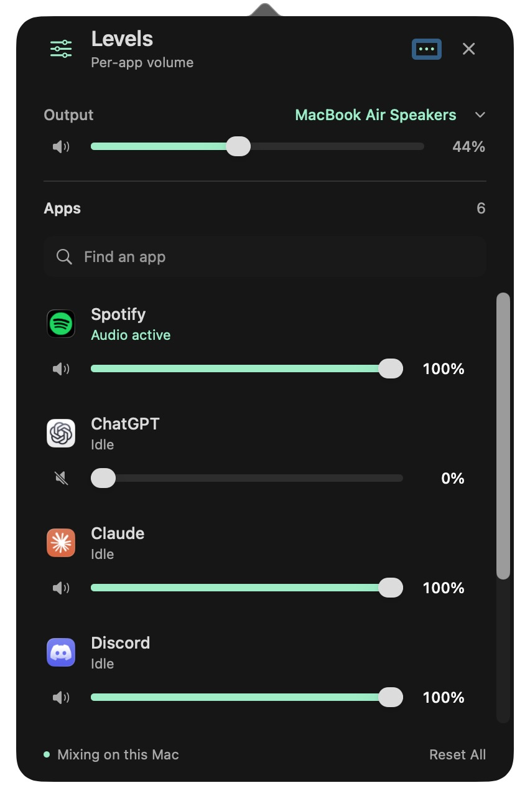
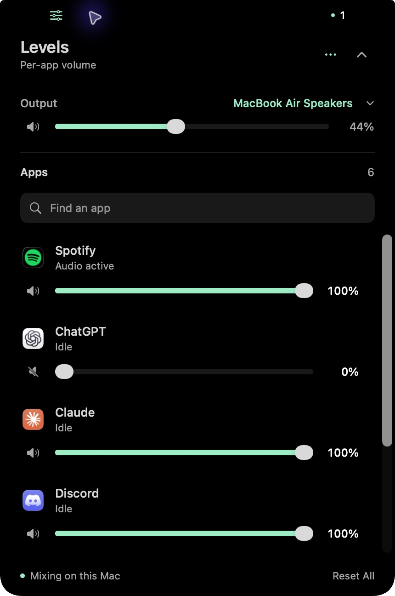

# Levels

A native Mac audio mixer with a choice of Dynamic Island or menu bar popover for independent application volume and mute, similar to the Windows Volume Mixer. Built for macOS 14.2 or later using public Core Audio process taps. No third-party dependencies, audio driver, privileged helper, or network access.

## Screenshots

Both views share the same app volumes, mute controls, and active-first ordering. These are captures of the installed Levels app.

| Menu Bar Popover | Dynamic Island (expanded) |
| --- | --- |
|  |  |

## Install the download

Download the [universal test DMG](https://github.com/LeeSinLiang/Levels/releases/download/v0.1.0-test/Levels-0.1.0-universal-test.dmg) from the [v0.1.0-test release](https://github.com/LeeSinLiang/Levels/releases/tag/v0.1.0-test).

Open `Levels-0.1.0-universal-test.dmg`, drag **Levels.app → Applications**, then eject the disk image and open **Levels** from Applications or Spotlight. The bundled **Start Here** guide covers installation, audio permission, both display modes, troubleshooting and uninstalling. It is also available from **••• options → Levels Setup Guide**.

Requires **macOS 14.2 or later**. The universal app includes Apple Silicon and Intel binaries; live runtime verification so far is on Apple Silicon. End users need no Swift, Xcode, terminal commands, audio driver or installer.

The current artifact is a **test build**, ad-hoc signed and not notarized. A downloaded copy can require **System Settings → Privacy & Security → Open Anyway**, following [Apple's instructions](https://support.apple.com/102445), for a copy you trust. Developer ID signing and notarization are required before advertising a public release that passes normal macOS security checks. See [the release workflow](docs/RELEASING.md).

## Use Levels

The built app is `build/Levels.app`. Double-click it to open the saved display mode. In the mixer's **••• options**, choose **Dynamic Island** or **Menu Bar Popover** under **Display Mode**. The choice stays saved after relaunch. Switching keeps the same app levels, mute states, and audio routes.

**Dynamic Island:** on a MacBook with a notch, it wraps the actual camera housing; the full mixer expands below the camera. Hover briefly over either side of the notch, click the mixer glyph, or use the sliders icon in the menu bar to open it. Click the up chevron or outside the island to collapse it. Escape closes it after it has keyboard focus. External displays without a notch use a floating pill near the top center when no notched display is available.

**Menu Bar Popover:** click the sliders icon in the menu bar to open a compact charcoal mixer. macOS attaches its arrow to that icon, and the app bounds the scrolling list to the current display. Active audio labels use mint to distinguish them from idle apps. Use the close button, Escape, or an outside click to dismiss it. The island is removed while popover mode is selected. Both interfaces offer the same volume controls, search, options, and active-first app ordering.

On first use, choose **Enable App Volume**, allow **System Audio Recording**, and choose **Check Again** if the initial check finished before you allowed access.

If necessary, enable Levels in **System Settings → Privacy & Security → Screen & System Audio Recording**. The wording and placement vary by macOS version. The app's options menu links to Audio Privacy Settings.

Play audio in an app to make it appear. Apps playing audio come first, followed by idle apps; names are alphabetized within each group. Drag its slider to change only that app, or use its speaker button to mute it. Levels are remembered by application bundle ID. Dragging a muted app's slider above zero unmutes it. The output selector and system slider control the Mac's default output; an application that explicitly uses a different output follows that output instead.

The options menu also offers a normal mixer window, inactive apps, pause, audio-access checking, and quit. **Reset All** restores app volumes to 100% and removes their mute state. **Pause App Mixing** releases all audio routes while keeping saved levels. Quitting restores normal application audio. The app rechecks access and restores saved levels the next time it opens if mixing was enabled.

The existing bundle identifier is retained across the rename from Sound Mixer to preserve saved settings. Quit an older Sound Mixer copy before opening Levels. Rebuilding or changing the signer can require granting audio permission again.

## Privacy and implementation

Per-app control reads an application's output through a private process tap, scales Float32 samples, and plays them into a private aggregate containing the app's output device. Original output is muted only while the tap is being read. All routes and taps are explicitly destroyed on quit. Their lifetime is also bounded by the app process.

Before enabling this path, a non-mutating self-test taps the app's own near-silent test signal. Merely creating a tap does not prove macOS has permitted actual audio capture, so a real captured signal is required. Failure keeps app sliders disabled and leaves application sound alone. Audio is processed in memory; it is never recorded to files or sent over the network. The app requests no microphone or Accessibility permission.

The realtime callback is C, using lock-free atomics for control changes. It does no allocation, locking, file IO, or Swift/Objective-C calls. Gain changes ramp over up to 20 ms to reduce clicks. Apps at 100% and unmuted are not tapped. Device changes rebuild affected routes; sleep releases them, and wake checks audio access again. A route that stops delivering frames while its application reports active output is released and displays a retry error.

## Build and test

Requires Swift 6 and Apple's Command Line Tools; Xcode is optional.

```sh
zsh scripts/build-app.sh
open "build/Levels.app"
```

Run the regression checks (also works with Command Line Tools without Xcode):

```sh
zsh scripts/test.sh
```

List live outputs and audio applications without creating taps or changing volume:

```sh
"build/Levels.app/Contents/MacOS/Levels" --list
```

Launch with `--window` to open the normal window instead of the saved display mode.

For audio-access diagnostics, `--check-audio-access` runs the same in-memory, near-silent self-test against only Levels' own audio. It can trigger macOS's recording consent prompt. It prints JSON and exits with zero only if samples were actually received. `--list` and `--check-audio-access` report errors through a nonzero exit code.

Create a downloadable test DMG with an Applications shortcut, setup guide and SHA-256 checksum:

```sh
zsh scripts/package-release.sh --development
```

The complete signing, notarization and release-check instructions are in [docs/RELEASING.md](docs/RELEASING.md). Release artifacts and private review screenshots are excluded from Git.

Tests cover independent gain, zero-volume output, interleaved/planar stereo, mono downmix, physical-input skipping, output bounds, gain ramps, invalid samples, non-replaying probes, saved settings, helper identity resolution, and island placement on notched and external displays. Passing these tests does not establish device compatibility or replace listening to real applications.

## Current limits

- Volume applies to an application, not individual browser tabs. Chromium audio helpers are grouped with the owning application when their bundle identifiers match. Shared WebKit audio is labelled **Safari & Web Audio** because public process information does not reliably identify the originating WebKit application.
- An app appears after it has connected to macOS audio. **Show Inactive Apps** includes recognised audio clients even while idle. Recently active apps remain visible for 20 seconds; apps with saved attenuation/mute remain visible while their audio process exists.
- Processing adds an audio buffer of latency. Starting, stopping, changing outputs, or replacing an app's helper process can cause a short sound interruption. The exact timing depends on the device and has not been measured across devices.
- Mono/stereo outputs only. Multi-channel outputs, applications with several simultaneous outputs, and exclusive device access are not supported; route errors leave the app's original audio path intact.
- Audible Chrome attenuation has been confirmed on AirPods Pro. Bluetooth reconnects, HDMI/USB, device disconnects, sleep/wake, helper restarts, Intel runtime and the macOS 14.2 minimum need separate hardware testing. This local build is not a notarized public release.

The API design follows [Apple's Core Audio taps documentation](https://developer.apple.com/documentation/CoreAudio/capturing-system-audio-with-core-audio-taps) and the installed SDK headers.
